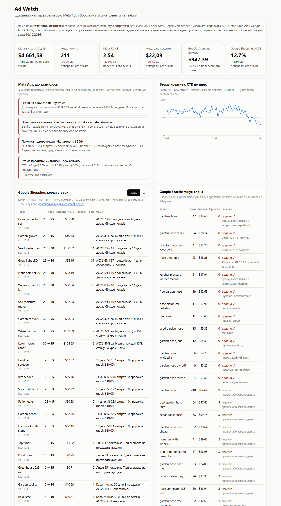
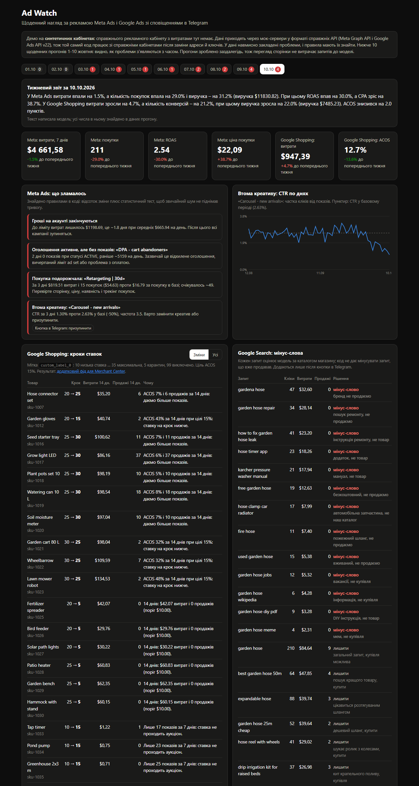

# Ad Watch

A daily watchdog for Meta Ads and Google Ads that sends problems to Telegram and changes
nothing in the ad accounts until a person taps a button. It catches creative fatigue, a
sudden jump in cost per purchase, ads that are "active" but get no impressions, and an
account about to hit its spend cap; on Google it moves Shopping products between bid steps
and collects negative keywords.

**Live demo:** https://ad-watch-six.vercel.app (UI in Ukrainian)



The ad accounts are synthetic: there is no real account with real spend behind this demo.
The data is served by mock servers that speak the **real wire formats** (Meta Graph API
insights, Google Ads API v22 `searchStream` with GAQL), so the same client code runs against
`graph.facebook.com` and `googleads.googleapis.com` by switching `ADS_MODE=live` and keys.
Problems are planted in the data on purpose, and the rules are measured on finding them.

## What it does

| Part | How | Why this way |
|---|---|---|
| Meta: creative fatigue | ad CTR of the last 3 days vs its own days 8-28; alert when it fell 30%+ **and** a two-proportion z-test gives z ≥ 3 | a percentage alone fires on small ads with normal noise |
| Meta: cost per purchase spike | campaign purchases in the last 3 days vs what the same spend bought before; Poisson test p ≤ 0.01 and CPA ≥ 1.8× | "0 purchases today" is normal for a small campaign, not an incident |
| Meta: zero delivery | status `ACTIVE`, 0 impressions for 2 days, ~500+/day before | usually a rejected ad or a payment problem; the UI still says "active" |
| Meta: spend runway | `spend_cap - amount_spent` (cents, as the API returns them) divided by the 7-day average spend | everything stops when the cap is hit, often at night |
| Google Shopping bid steps | each product carries `custom_label_0` (5 quarantine, 10..35 bid steps, 99 excluded); rules over 14 days move it; output is a supplemental feed CSV for Merchant Center | labels live in Merchant Center, not in the Ads API; product groups split by the label hold the bids |
| Google Search negatives | the model judges every search term against the catalogue; code then drops any term that already sold; the dictionary rules are the fallback when the model is unavailable | measured below: 83-87% vs 66% for the dictionary |
| Telegram | a daily overview plus one message per actionable problem with **Pause** / **Add negatives** buttons; callback data is HMAC-signed, the webhook checks Telegram's secret header and the chat id | money and account changes go through a person |
| Weekly report | numbers computed in code; the model only writes 3-5 sentences, and every number in its text is matched against the data, otherwise the template is sent | the model must not invent or recompute figures |

**No automatic schedule on the demo**, on purpose: a daily cron would spend model tokens every
day for nobody. The dashboard shows 10 daily runs (1-10 October) made once by
`scripts/make_runs.py` against one account history, each run seeing only the days up to its own
date, so problems appear over time: nothing on 1-2 October, creative fatigue from the 3rd, the
cost spike from the 7th, zero delivery and the spend cap on the 9th-10th. All 10 runs together
cost $0.007 in model calls; viewing the page calls no model. A report to Telegram is sent on
demand: `GET /api/cron/daily` with `Authorization: Bearer $CRON_SECRET`. For a real account,
add `"crons"` to `vercel.json` (e.g. `0 6 * * *`).

## Measured

`eval/run_eval.py`, raw output in [`eval/results.json`](eval/results.json).

**Meta rules, 300 synthetic accounts** with random incidents (each type in about half of
the accounts, random ad, strength and duration) and 20 clean accounts:

| Problem | Found (recall) | Alerts that were right (precision) |
|---|---|---|
| Creative fatigue | 136 / 157 (86.6%) | 100% |
| Cost per purchase spike | 133 / 161 (82.6%) | 97.1% (4 false) |
| Zero delivery | 147 / 147 | 100% |
| Spend runway < 3 days | 156 / 156 | 100% |
| False alerts on 20 clean accounts | 0 | |

Without the statistical tests (percentage thresholds only) false cost-spike alerts went from
4 to 9 and fatigue got 1 false alert; recall rose by 1-3 points. The tests buy precision for a
little recall, which is the right trade for something that pings a phone.

**Google Shopping bid steps, 100 synthetic shops, 4 000 products.** Each product has a
behaviour type with a known right answer (a steady product at 12% ACOS should be left alone,
a winner at 6% raised, an expensive one at 30% lowered, a product with spend and no sales
quarantined, and so on):

| Rules version | Right decision | Steady products wrongly moved | Label changes per shop |
|---|---|---|---|
| Naive: ACOS over 7 days, 1 sale is enough | 75.6% | 51.0% | 29.2 |
| ACOS over 14 days, 2-3 sales required, ±20% band | 82.8% | 35.2% | 27.2 |
| + one-sale tolerance (final) | **86.4%** | **18.4%** | 23.9 |

The price of the final version: expensive products are caught less often (59.8% vs 72.3%),
because with 2-3 sales in two weeks one sale more or less flips the verdict. Moving a bid
back and forth every week costs more than reacting a week later.

**Negative keywords, 47 labelled search terms** (labels are mine; 12 are traps such as
"garden hose free shipping", "hose repair kit", "gardena compatible connector", "garden hose
rental"). Model: `openai/gpt-oss-120b` on Groq, temperature 0, five runs:

| Approach | Right | Negatives found | Traps right | Cost per run |
|---|---|---|---|---|
| Dictionary + "spends without sales" rules | 66.0% | 78.3% | 2 / 12 | $0 |
| Rules, model only for unclear terms | 72-75% | 78.3% | 3 / 12 | $0.0004 |
| Model on every term | 79-85% | 100% | 8 / 12 | $0.0009 |
| **Model on every term + "a term that sold is never negative" (used)** | **83-87%** | **100%** | 8 / 12 | $0.0009 |

The dictionary cannot see negatives without a trigger word ("aquarium hose", "garden hose
song", "rental"), so giving the model only the dictionary's doubtful cases could not fix the
misses. The model's own mistakes go the other way: it proposes products the shop sells
("hose repair kit", "gardena compatible connector", "raised bed kit wood"). The sales rule in
code removes the ones that already sold; the rest is why a person approves the list in
Telegram. The same prompt gives 79-85% across runs at temperature 0, so one run is not a result.
I did not tune the prompt on these 47 terms: they are the test set.

Pipeline on the mock: Meta API ~70 ms, Google API ~80 ms, whole daily run ~160 ms without the
model, ~2-3 s with it. Model cost: about $0.001 per daily run, about $1 per 1 000 runs.
Tests: 34, no network, no API keys, run under a 1 GB memory cap in Docker
(`scripts/run_tests_capped.ps1`) and in GitHub Actions.

## Where it breaks / limits

- **Seven days of ACOS is noise.** The first version of the bid rules changed 34 of 40
  products in one day, including half of the products that were fine. A product with one
  sale a week has an ACOS that jumps between 6% and 40% by chance. Fixed with a 14-day
  window, a minimum number of sales and the one-sale tolerance; the table above is the
  measurement of that fix.
- **A fixed "spent $10 without a sale" rule is wrong for expensive products.** For a $300
  item $10 is less than one normal sale costs. The threshold is now twice what one sale may
  cost at the target ACOS, using the product's own average order value.
- **Google omits zeros.** A product with no conversions has no `conversions` key, and a
  product with no activity has no `metrics` object at all; int64 values arrive as strings.
  The mock reproduces this, and a test caught my own assumption that `metrics` is always there.
- **"Active" does not mean delivering.** Zero delivery is found only by comparing status with
  impressions; Meta does not report it as an error.
- **The negative-keyword dictionary over-fires.** "free" also matches "free shipping";
  "repair" also matches "hose repair kit", which is a product. Terms with sales are never
  proposed, and everything goes through a button, but a dictionary alone is not enough.
- **My number checker rejected correct reports.** In the first batch of 10 weekly reports, 5
  were rejected. Reading them showed two different causes. One was mine: the model writes the
  typographic minus `−` (U+2212), the checker did not know it, so `−22.7%` was read as +22.7
  and did not match −22.7 in the data. The other was real: given both weeks' absolute numbers,
  the model computed its own percentages and got some wrong, and once called ACOS "cost of
  sale". Fixes: the checker normalises minus signs and compares absolute values; the model now
  gets this week's numbers and ready-made changes only, without last week's absolutes, so it
  has nothing to recompute. Result: 10 of 10 accepted, and I checked two of them by hand,
  direction words included. The checker still does not verify direction ("rose" vs "fell").
- **What the mock does not cover:** Meta's learning phase, attribution windows and delayed
  conversions (yesterday's numbers still change for days), Google's search terms are 30-day
  totals here, and real token lifecycles (Meta System User token, Google OAuth refresh).
- **State is per serverless instance.** Paused ads and added negatives on the demo live in
  the instance memory; the Telegram message itself is edited after a tap, so a button
  cannot be pressed twice.

## Going live

1. Meta: an app with the Marketing API use case, a System User in Business Manager with
   access to the ad account, a token with `ads_read` (and `ads_management` for pausing).
   Managing other businesses' accounts in production may require the higher Marketing API
   access tier, App Review and Business Verification; check Meta's current requirements.
2. Google Ads: a developer token (API Center), OAuth client and refresh token, the manager
   account id as `login-customer-id`. The built-in n8n Google Ads node only reads campaigns,
   so writes go through HTTP, as here.
3. Merchant Center: a supplemental feed that fetches `/api/feed.csv` on a schedule.
4. `ADS_MODE=live` and the keys from `.env.example`.

## Run locally

```bash
pip install -r requirements-dev.txt
PYTHONPATH=src uvicorn adwatch.web:app --port 7860
# Telegram: TELEGRAM_BOT_TOKEN, TELEGRAM_CHAT_ID, TELEGRAM_WEBHOOK_SECRET, CRON_SECRET in .env
```

Stack: Python, FastAPI, httpx (async, `ASGITransport` for the in-process mock), Pydantic,
hand-drawn SVG, Telegram Bot API, Groq (`openai/gpt-oss-120b`). One Python function on Vercel.

Verified end to end on the deployed service (11.10.2026): Vercel cron call → 5 Telegram messages →
taps on **Pause** and **Add negatives** → the ad paused and the negatives added in the mock
accounts, both messages edited with the result, no webhook errors.

| Dark mode |
|---|
|  |
