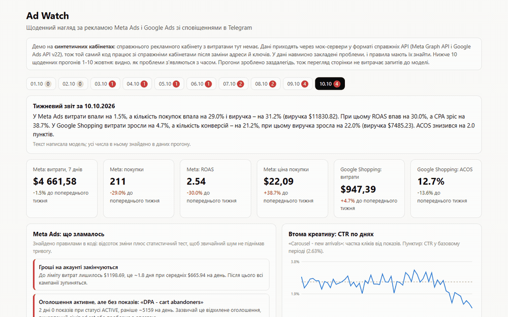
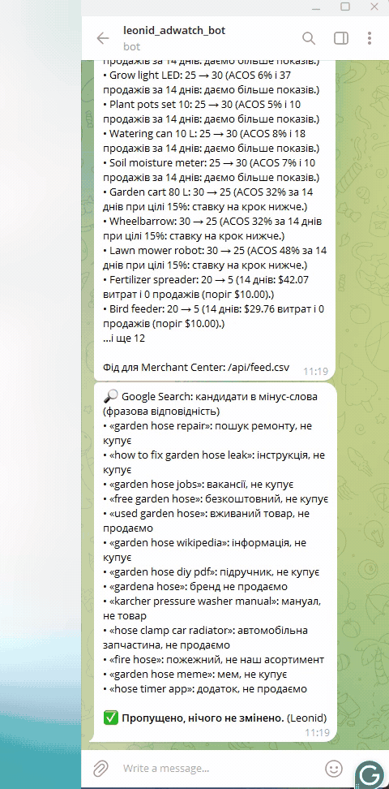

[English](README.md) | **Українська**

# Ad Watch

Щоденний нагляд за рекламою Meta Ads і Google Ads: проблеми приходять у Telegram, а в
рекламних кабінетах нічого не змінюється, доки людина не натисне кнопку. Сервіс помічає
втому креативу, різке дорожчання покупки, оголошення, які «активні», але не отримують
показів, і рахунок, що от-от упреться в ліміт витрат; у Google він переводить товари
Shopping між кроками ставок і збирає мінус-слова.

**Живе демо:** https://ad-watch-six.vercel.app



Telegram, записано на задеплоєному сервісі: огляд, сповіщення про втому креативу, натиснуто
**Призупинити**, повідомлення змінилось на результат; далі мінус-слова, натиснуто **Додати всі**,
додано 13. Натискання надіслано тим самим `callback_query`, який Telegram шле на вебхук
(помаранчева крапка позначає кожне); список особистих чатів ліворуч розмитий.



Рекламні кабінети синтетичні: за демо немає справжнього кабінету зі справжніми витратами.
Дані віддають мок-сервери у **справжніх форматах API** (insights Meta Graph API, Google Ads
API v22 `searchStream` з GAQL), тож той самий код клієнтів працює з `graph.facebook.com` і
`googleads.googleapis.com` після перемикання `ADS_MODE=live` і ключів. Проблеми закладені в
дані навмисно, і правила заміряні на тому, як вони їх знаходять.

## Що робить

| Частина | Як | Чому так |
|---|---|---|
| Meta: втома креативу | CTR оголошення за 3 останні дні проти його ж днів 8-28; тривога, коли впав на 30%+ **і** z-тест двох частот дає z ≥ 3 | лише відсоток спрацьовує на малих оголошеннях від звичайного шуму |
| Meta: дорожчання покупки | покупки кампанії за 3 дні проти того, скільки ті самі гроші купували раніше; тест Пуассона p ≤ 0.01 і CPA ≥ 1.8× | «0 покупок сьогодні» для малої кампанії норма, а не інцидент |
| Meta: оголошення без показів | статус `ACTIVE`, 0 показів 2 дні, раніше ~500+ на день | зазвичай відхилене оголошення чи проблема з оплатою; інтерфейс досі пише «активне» |
| Meta: запас бюджету | `spend_cap - amount_spent` (у центах, як віддає API) поділити на середні витрати за 7 днів | коли ліміт вичерпано, зупиняється все, часто вночі |
| Google Shopping: кроки ставок | у кожного товару `custom_label_0` (5 карантин, 10..35 кроки ставки, 99 виключено); правила за 14 днів міняють мітку; результат: додатковий фід CSV для Merchant Center | мітки живуть у Merchant Center, а не в Ads API; групи товарів за міткою тримають ставки |
| Google Search: мінус-слова | модель оцінює кожен пошуковий запит за каталогом; код потім прибирає запити, що вже продавали; словникові правила лишаються запасним варіантом, коли модель недоступна | заміряно нижче: 83-87% проти 66% у словника |
| Telegram | щоденний огляд плюс окреме повідомлення на кожну проблему з дією, кнопки **Призупинити** / **Додати мінус-слова**; дані кнопки підписані HMAC, вебхук перевіряє секретний заголовок Telegram і чат | гроші й зміни в кабінеті проходять через людину |
| Тижневий звіт | числа рахує код; модель лише пише 3-5 речень, і кожне число в її тексті звіряється з даними, інакше йде шаблон | модель не має вигадувати чи перераховувати цифри |

**На демо немає автоматичного розкладу**, свідомо: щоденний cron витрачав би токени моделі
щодня без глядача. Дашборд показує 10 щоденних прогонів (1-10 жовтня), зроблених один раз
`scripts/make_runs.py` на одній історії кабінету, і кожен прогін бачить дні лише до своєї дати,
тож проблеми з'являються з часом: 1-2 жовтня нічого, з 3-го втома креативу, з 7-го дорожчання
покупки, 9-10-го оголошення без показів і ліміт бюджету. Усі 10 прогонів разом коштували $0.007
на виклики моделі; перегляд сторінки модель не викликає. Звіт у Telegram надсилається на вимогу:
`GET /api/cron/daily` з `Authorization: Bearer $CRON_SECRET`. Для справжнього кабінету досить
додати `"crons"` у `vercel.json` (наприклад, `0 6 * * *`).

## Заміри

`eval/run_eval.py`, сирі результати в [`eval/results.json`](eval/results.json).

**Правила Meta, 300 синтетичних кабінетів** з випадковими проблемами (кожен тип приблизно в
половині кабінетів, випадкові оголошення, сила й тривалість) і 20 чистих кабінетів:

| Проблема | Знайдено (recall) | Правильних тривог (precision) |
|---|---|---|
| Втома креативу | 136 / 157 (86.6%) | 100% |
| Дорожчання покупки | 133 / 161 (82.6%) | 97.1% (4 хибні) |
| Оголошення без показів | 147 / 147 | 100% |
| Бюджету менше ніж на 3 дні | 156 / 156 | 100% |
| Хибні тривоги на 20 чистих кабінетах | 0 | |

Без статистичних тестів (лише пороги у відсотках) хибних тривог про дорожчання стало 9 замість
4, а втома дала 1 хибну; recall зріс на 1-3 пункти. Тести купують точність ціною трохи меншого
recall, і це правильний обмін для того, що будить телефон.

**Кроки ставок Google Shopping, 100 синтетичних магазинів, 4 000 товарів.** Кожен товар має тип
поведінки з відомою правильною відповіддю (стабільний товар з ACOS 12% не чіпати, переможця з 6%
підняти, дорогий з 30% опустити, товар з витратами і без продажів у карантин тощо):

| Версія правил | Правильне рішення | Стабільні товари, змінені дарма | Змін міток на магазин |
|---|---|---|---|
| Наївна: ACOS за 7 днів, вистачає 1 продажу | 75.6% | 51.0% | 29.2 |
| ACOS за 14 днів, потрібно 2-3 продажі, смуга ±20% | 82.8% | 35.2% | 27.2 |
| + допуск в один продаж (фінальна) | **86.4%** | **18.4%** | 23.9 |

Ціна фінальної версії: дорогі товари ловляться рідше (59.8% проти 72.3%), бо при 2-3 продажах
за два тижні один продаж більше чи менше перевертає висновок. Смикати ставку туди-назад щотижня
коштує більше, ніж відреагувати тижнем пізніше.

**Мінус-слова, 47 розмічених пошукових запитів** (розмітка моя; 12 з них пастки, як-от
«garden hose free shipping», «hose repair kit», «gardena compatible connector», «garden hose
rental»). Модель `openai/gpt-oss-120b` на Groq, temperature 0, п'ять прогонів:

| Підхід | Правильно | Знайдено мінус-слів | Пасток правильно | Ціна прогону |
|---|---|---|---|---|
| Словник + правило «витрати без продажів» | 66.0% | 78.3% | 2 / 12 | $0 |
| Правила, модель лише для сумнівних | 72-75% | 78.3% | 3 / 12 | $0.0004 |
| Модель на кожному запиті | 79-85% | 100% | 8 / 12 | $0.0009 |
| **Модель на кожному запиті + «запит, що продавав, не мінусуємо» (використано)** | **83-87%** | **100%** | 8 / 12 | $0.0009 |

Словник не бачить мінус-слів без слова-тригера («aquarium hose», «garden hose song»,
«rental»), тож віддати моделі лише сумнівні випадки словника не могло виправити пропуски.
Помилки самої моделі йдуть в інший бік: вона пропонує товари, які магазин продає («hose repair
kit», «gardena compatible connector», «raised bed kit wood»). Правило продажів у коді прибирає
ті, що вже продавали; решта і є причиною, чому список затверджує людина в Telegram. Той самий
промпт дає 79-85% між прогонами навіть при temperature 0, тож один прогін не результат. Промпт
під ці 47 запитів я не підганяв: це тестовий набір.

Конвеєр на моку: Meta API ~70 мс, Google API ~80 мс, весь щоденний прогін ~160 мс без моделі,
~2-3 с з нею. Модель: приблизно $0.001 за прогін, приблизно $1 за 1 000 прогонів.
Тести: 34, без мережі й ключів, під лімітом пам'яті 1 ГБ у Docker
(`scripts/run_tests_capped.ps1`) і в GitHub Actions.

## Де ламається / обмеження

- **ACOS за сім днів це шум.** Перша версія правил ставок змінила 34 з 40 товарів за один день,
  зокрема половину тих, що були в нормі. Товар з одним продажем на тиждень має ACOS, що
  випадково стрибає між 6% і 40%. Виправлено вікном 14 днів, мінімальною кількістю продажів і
  допуском в один продаж; таблиця вище і є заміром цього виправлення.
- **Фіксоване правило «витратив $10 без продажу» хибне для дорогих товарів.** Для товару за
  $300 десять доларів менше, ніж коштує один звичайний продаж. Поріг тепер дорівнює вартості
  двох продажів за цільовим ACOS і рахується із середнього чека самого товару.
- **Google не віддає нулі.** Товар без конверсій не має ключа `conversions`, а товар без
  активності не має навіть об'єкта `metrics`; int64 приходять рядками. Мок це відтворює, і тест
  спіймав моє власне припущення, що `metrics` є завжди.
- **«Активне» не означає «крутиться».** Оголошення без показів видно лише з порівняння статусу
  з показами; Meta не повідомляє про це як про помилку.
- **Словник мінус-слів спрацьовує зайве.** «free» ловить і «free shipping», «repair» ловить і
  «hose repair kit», а це товар. Запити з продажами ніколи не пропонуються, і все йде через
  кнопку, але самого словника замало.
- **Моя перевірка чисел відхиляла правильні звіти.** З перших 10 тижневих звітів 5 були
  відхилені. Розбір показав дві різні причини. Перша моя: модель пише типографський мінус `−`
  (U+2212), перевірка його не знала, і `−22.7%` читалось як +22.7, що не збігалось з −22.7 у
  даних. Друга справжня: маючи абсолютні цифри обох тижнів, модель сама рахувала відсотки й
  частину порахувала неправильно, а раз назвала ACOS «вартістю продажу». Виправлення: перевірка
  нормалізує мінуси й порівнює модулі; модель тепер отримує цифри цього тижня і готові зміни, без
  абсолютних цифр минулого, тож їй нема чого перераховувати. Результат: 10 з 10 прийнято, два я
  перевірив вручну разом зі словами напряму. Напрям («зросли» чи «впали») перевірка досі не
  контролює.
- **Чого мок не покриває:** фазу навчання Meta, вікна атрибуції й відкладені конверсії
  (вчорашні цифри ще змінюються кілька днів), пошукові запити Google тут є підсумками за 30 днів,
  і справжній життєвий цикл токенів (System User токен Meta, OAuth refresh у Google).
- **Стан живе в межах одного serverless-інстансу.** Призупинені оголошення й додані мінус-слова
  в демо лежать у пам'яті інстансу; саме повідомлення Telegram після натискання редагується, тож
  кнопку не можна натиснути двічі.

## Перехід на справжні кабінети

1. Meta: застосунок із use case Marketing API, System User у Business Manager з доступом до
   рекламного акаунта, токен з `ads_read` (і `ads_management` для паузи). Керування акаунтами
   інших компаній у продакшні може вимагати вищого рівня доступу Marketing API, App Review і
   Business Verification; перевіряйте актуальні вимоги Meta.
2. Google Ads: developer token (API Center), OAuth-клієнт і refresh token, id менеджерського
   акаунта в `login-customer-id`. Вбудована нода n8n Google Ads лише читає кампанії, тож запис
   іде через HTTP, як тут.
3. Merchant Center: додатковий фід, що за розкладом забирає `/api/feed.csv`.
4. `ADS_MODE=live` і ключі з `.env.example`.

## Запуск локально

```bash
pip install -r requirements-dev.txt
PYTHONPATH=src uvicorn adwatch.web:app --port 7860
# Telegram: TELEGRAM_BOT_TOKEN, TELEGRAM_CHAT_ID, TELEGRAM_WEBHOOK_SECRET, CRON_SECRET у .env
```

Стек: Python, FastAPI, httpx (async, `ASGITransport` для моку в тому ж процесі), Pydantic,
SVG-графіки вручну, Telegram Bot API, Groq (`openai/gpt-oss-120b`). Одна Python-функція на Vercel.

Перевірено наскрізно на задеплоєному сервісі (11.10.2026): ручний запуск щоденного звіту →
5 повідомлень у Telegram → натискання **Призупинити** і **Додати мінус-слова** → оголошення
призупинено, мінус-слова додано в мок-кабінетах, обидва повідомлення змінились на результат,
помилок вебхука немає.

| Темна тема |
|---|
|  |
